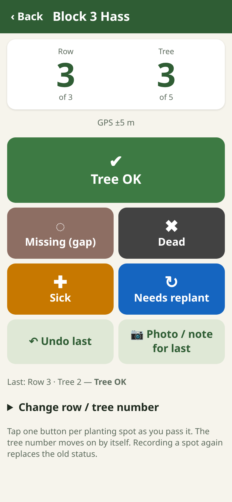

# Orchard Counter

A **free** phone app for counting trees **row by row** in orchards, groves, vineyards and plantations — avocado, apple, pear, olive, macadamia, citrus, stone fruit, nuts, grapevines, truffière host trees, woodlots. Find the gaps, dead and sick trees, get a **replant list by row and tree number**, see trees per hectare, and make a **rough yield estimate** from a few sample trees.

Usable anywhere in the world. Plain language, big buttons, works on cheap Android phones, **works offline after the first load**, no account, no server, no adverts. Data stays on your phone until you export it.

**Open the app:** https://johnrichardszpe-dot.github.io/orchard-counter/
(Then use the browser menu → *Add to Home screen* / *Install app*.)

By **John Richards**. Version 0.1.0.

## How to use
1. **New block** — name it, pick the crop, enter row spacing, tree spacing, number of rows and trees per row (or the row length). The app shows area per tree, **trees per hectare**, the **expected tree count** and block area.
2. **Walk a row** — at each planting spot tap one big button: **Tree OK / Missing (gap) / Dead / Sick / Needs replant**. The tree number moves on by itself and rolls over to the next row (optional “snake” numbering if you walk back down the next row). GPS (with accuracy) is saved with each tap. **Undo** fixes a wrong tap; **Change row / tree number** jumps.
3. **Photo / note** — open the last record to add a note (e.g. “collar rot”) and photos (compass bearing saved).
4. **Gaps & replant list** — positions recorded vs expected, gap %, missing + dead %, replant count, estimated living trees and replants for the whole block, and the list by row/tree. Share it as text.
5. **Quick yield sample** (optional) and **Export**: records CSV, replant list text file, JSON backup (restore on another phone).

## The maths
- **Area per tree** = row spacing × tree spacing (m²). **Trees per hectare** = 10 000 ÷ area per tree. Example: 7 m × 4 m = 28 m² → 357 trees/ha.
- **Trees per row** = as entered, or row length ÷ tree spacing + 1 (first tree at 0 m). **Expected trees** = rows × trees per row. **Block area** ≈ expected trees × area per tree.
- **Gap %** = missing ÷ positions recorded. **Missing + dead %** and **to-replant %** (missing + dead + needs replant) likewise. If a spot is recorded twice, the latest record counts.
- **Whole-block estimates** = expected trees × (share of recorded positions) — only fair if the rows you walked are typical.
- **Yield sample:** average fruit per sample tree × number of productive trees = block fruit; × average fruit weight = tonnes. The ± range is the 95 % Student-t interval of the mean (mean ± t × SD ÷ √n) scaled to the block. The app also shows roughly how many trees you'd need for ±10 % (n ≈ (1.96 × CV ÷ 10)²).

> **Yield caveat:** a hand count of a few trees is a rough guide, not a crop forecast. Pick ≥ 10 trees spread across light, medium and heavy parts of the block. Hidden fruit, fruit drop, uneven blocks, multiple picks and packout losses all make the real harvest differ. Compare with your packhouse figures each year to calibrate.

## Methods and sources
- **Planting density:** DPIRD WA, *Growing avocados in Western Australia* (Bulletin) — 7 m × 4 m = 28 m² per tree; close spacing is common in WA and needs size control ([DPIRD library](https://library.dpird.wa.gov.au/cgi/viewcontent.cgi?article=1143&context=bulletins)). WA apple spacings 4.5 × 2.0 to 5.5 × 3.5 m (*An apple production system for Western Australia*, [Acta Hort. 240](https://www.actahort.org/books/240/240_17.htm)); DPIRD [narrow orchard systems](https://www.dpird.wa.gov.au/research/research-areas/horticulture-research/narrow-orchard-systems/) (2.5 m rows, 2D canopies).
- **Yield sampling:** California Avocado Growers [crop estimate steps](https://www.californiaavocadogrowers.com/industry/crop-statistics/crop-estimate-form) — sample at least 10 trees in light, medium and heavy areas, average the fruit count, multiply by trees in the block (tree count from spacing, allowing for roads and gaps). Hort Innovation project **AV18002** *Implementing precision agriculture solutions in Australian avocado production systems* ([report](https://www.horticulture.com.au/information-hub/our-projects/project-reports/av18002)) and Rahman et al. (2020, UNE, *Exploring the potential of high resolution satellite imagery for yield prediction of avocado and mango*) — 18 trees (6 each from high, medium and low vigour zones); visual counts of a few trees “can be highly inaccurate if the sampled trees are not representative”.
- **Statistics:** standard 95 % confidence interval for a mean with Student-t values (any introductory statistics text).

## Honest limits
- A counting notebook — not a certified orchard audit, crop forecast, insurance or biosecurity assessment.
- Phone GPS is often ±5–15 m: good for finding the row, not the exact tree. Row and tree numbers are the reliable address.
- The yield range ignores counting error, hidden fruit and non-random sampling, so the real uncertainty is larger.
- Data lives only on this phone; clearing browser data deletes it — export backups. English only for now (all text is in `strings.js` for translation).

## For developers
Plain HTML/CSS/JS, no build step. `node test.js` — trees/ha, expected trees, auto-advance (straight and snake), gap/replant summary, yield maths, CSV escaping / formula-injection guard. `browser-test.js` (puppeteer-core + Chrome) sets up a block, walks rows, adds a photo, checks the summary, replant list, yield sample, export and an offline reload: `PUPPETEER=/path/to/puppeteer-core node browser-test.js http://localhost:8000/ shot.png`. When you change any file, bump `CACHE` in `sw.js`. `more-tools.js` is the shared “More free tools by John Richards” list (same file in every app).

## More free tools by John Richards
- 🌲 [Tree Gauge](https://johnrichardszpe-dot.github.io/tree-gauge/) — forest basal area with the phone camera (angle-gauge method)
- 🌱 [Planting Survey](https://johnrichardszpe-dot.github.io/planting-survey/) — seedling survival %, trees per hectare and photo points
- 🔥 [Fuel Check](https://johnrichardszpe-dot.github.io/fuel-check/) — simple step-by-step bushfire fuel hazard check
- 🧭 [Forest Explorer](https://johnrichardszpe-dot.github.io/forest-explorer/) — school forest science kit: height, trunk, carbon
- 🦜 [Habitat Survey](https://johnrichardszpe-dot.github.io/habitat-survey/) — habitat trees, hollows, wildlife sightings and signs
- 🍎 [Orchard Counter](https://johnrichardszpe-dot.github.io/orchard-counter/) — row-by-row tree counts, gaps, replant list, yield sample *(this app)*
- 🚧 [Roadside Trees](https://johnrichardszpe-dot.github.io/roadside-trees/) — roadside and powerline tree hazards, trimming and work lists
- 🌌 [Universe map](https://johnrichardszpe-dot.github.io/universe-map/) — explore John Richards' map of the universe

The same list is in the app (About / More tools screen), from the shared `more-tools.js`.

Released under the MIT Licence (see LICENSE). Free for anyone, anywhere, to use, change and share. Copyright (c) 2026 John Richards.
